# Alferez-post1-u5 — Emuladores y Virtualización

Arquitectura de Computadores · Unidad 5 · Post-contenido · UFPS

**Estudiante:** Diego Alferez

Este repositorio único documenta el laboratorio guiado de la Unidad 5, dividido en dos partes: la Parte 1 trabaja con **DOSBox** (emulación de hardware x86 de 16 bits y programas en ensamblador con NASM) y la Parte 2 con **VirtualBox** (virtualización de un sistema operativo completo, Alpine Linux). El documento se mantiene como bitácora técnica y está redactado en tercera persona.

## 1. Entorno de trabajo

| Componente | Detalle |
|---|---|
| Sistema anfitrión | Windows 11 |
| DOSBox | 0.74-3 |
| NASM para DOS | 2.15.05 (compilado el 28 de agosto de 2020) |
| VirtualBox | versión 7.2.20 |
| SO huésped | Alpine Linux 3.19.x (Standard, x86_64) |
| VM `Lab5-Alpine` | 1 GB de RAM y 1 CPU al crearse; 2 GB y 2 CPUs tras el Paso 5; disco VDI dinámico de 10 GB; segundo disco VDI fijo de 4 GB |

## 2. Estructura del repositorio

```
Alferez-post1-u5/
├── README.md
├── dosbox.conf                 (Parte 1)
├── src/                        (Parte 1) saludo.asm, entrada.asm, ciclos.asm
├── bin/                        (Parte 1) saludo.com, entrada.com, ciclos.com
├── VBoxManage_commands.sh      (Parte 2)
└── capturas/                   capturas de ambas partes
```

Los archivos `.ova` y el disco fijo `Lab5-Alpine-fixed.vdi` no se suben al repositorio por su tamaño (ver `.gitignore`); se documentan con capturas.

---

## 3. Parte 1 — DOSBox y ensamblador

El estudiante creó el directorio de trabajo, inicializó Git en la rama `main` y configuró `dosbox.conf` para montar la carpeta del proyecto como unidad `C:`. Todos los comandos de ensamblado se ejecutan desde la raíz `C:\`, por ejemplo `nasm -f bin src\saludo.asm -o bin\saludo.com`.

**Checkpoint 1 — estructura:** 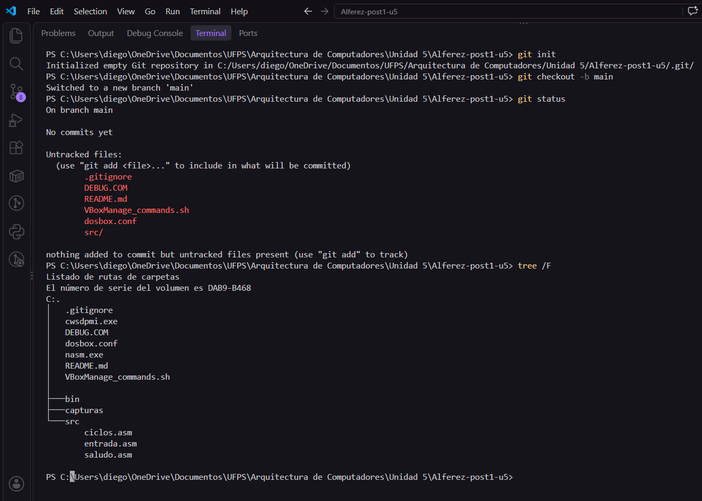

**Checkpoint 2 — DOSBox con NASM:** 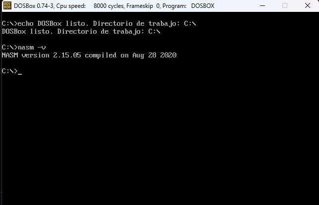

**Checkpoint 3 — `saludo.com` (INT 21h función 09h):** 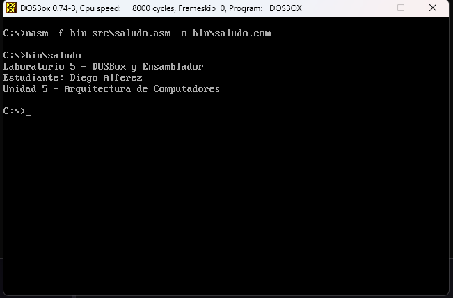

**Checkpoint 4 — `entrada.com` (INT 21h funciones 07h, 02h y 09h):** 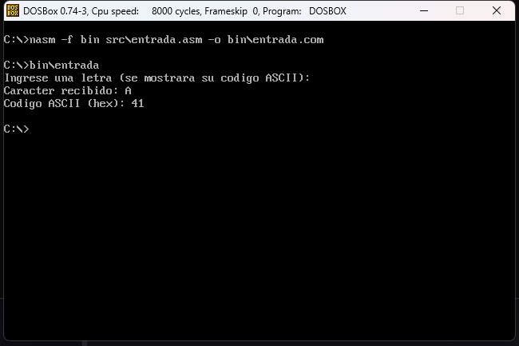

**Checkpoint 5 — sesión con DEBUG sobre `saludo.com`** (`-r`, `-u`, `-t`, `-p` y `-g`): 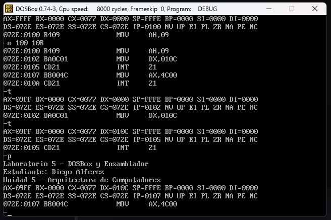
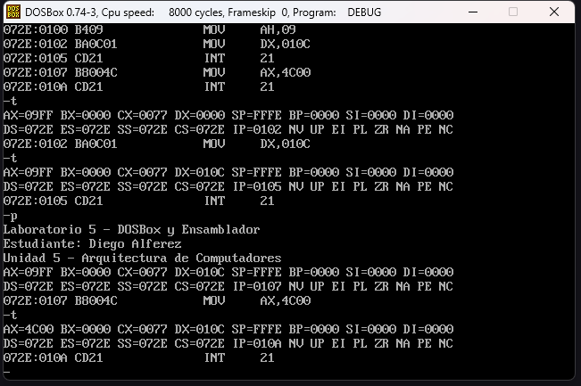

**Checkpoint 6 — `ciclos.com` con `cycles=8000`** (INT 21h función 2Ch): 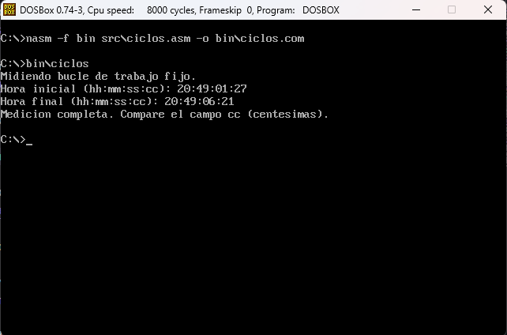

### Comparación del valor de `cycles` (Checkpoint 7)

El número de iteraciones es idéntico en las tres corridas (300 × 65535); solo cambia `cycles` en `dosbox.conf`.

| Corrida | cycles | Hora inicial (hh:mm:ss:cc) | Hora final (hh:mm:ss:cc) | Duración observada (centésimas) |
|---|---|---|---|---|
| 1 | 8000 | 20:49:01:27 | 20:49:06:21 | 494 |
| 2 | 1000 | 20:53:56:61 | 20:54:35:99 | 3938 |
| 3 | 20000 | 20:59:10:67 | 20:59:12:65 | 198 |

En la corrida 2 el minuto cambió de 53 a 54 durante la medición, por lo que se sumaron 6000 centésimas a la hora final para calcular la duración. Las duraciones son inversamente proporcionales a cycles: con cycles=1000 (3938 centésimas) el bucle tarda unas 8 veces lo que tarda con cycles=8000 (494), y con cycles=20000 (198) tarda unas 2,5 veces menos, la misma relación que hay entre los valores de cycles. Esto confirma que cycles controla la velocidad de emulación y no la corrección del programa, que ejecuta exactamente las mismas iteraciones en las tres corridas.

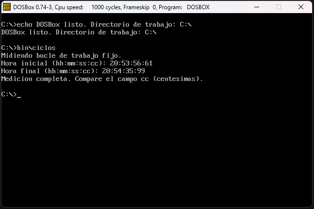
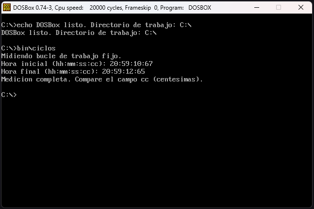

### Decisión técnica 1 — ¿qué valor de `cycles` es el correcto para este laboratorio?

El valor correcto para este laboratorio es uno fijo, `cycles=8000`. Con `cycles=max`, DOSBox emula tantas instrucciones por segundo como el procesador anfitrión permita, que en un equipo moderno son decenas o cientos de millones; el bucle de `ciclos.com`, cuyo tamaño es fijo en el código fuente, terminaría en una fracción del tiempo que tarda con 8000 y la diferencia entre la hora inicial y la final se acercaría a cero centésimas. Como la duración dependería de la potencia del equipo y no del programa, la medición quedaría invalidada: el bucle es solo un mecanismo de espera, el mismo recurso que usaron muchos programas y juegos de la era DOS. Con `cycles=auto` ocurre algo parecido, porque DOSBox ajusta el valor dinámicamente y el resultado cambia entre equipos y ejecuciones. Un valor fijo desacopla la velocidad de emulación del hardware real y obliga a cualquier equipo a emular aproximadamente la misma cantidad de instrucciones por unidad de tiempo, de modo que las mediciones de distintos estudiantes sean comparables y reproducibles. Fuera de este laboratorio, `cycles=max` o `cycles=auto` son la opción correcta al ejecutar software de productividad moderno escrito para DOS (compiladores, editores o programas pesados en modo protegido), donde no hay temporización atada al reloj del procesador y se busca la mayor velocidad posible.

### Decisión técnica 2 — tiempo emulado en DOSBox frente a los ciclos de CPU reales

El valor `cycles` de `dosbox.conf` y la frecuencia del procesador anfitrión no son comparables: `cycles` indica cuántas instrucciones x86 de 16 bits intenta emular DOSBox por milisegundo de tiempo virtual, mientras que los gigahercios del anfitrión indican ciclos de reloj físicos del silicio. Compararlos es un error de categoría, como comparar páginas por minuto con kilómetros por hora. Cada instrucción emulada exige que DOSBox la interprete por software: la decodifica, actualiza registros, banderas y memoria virtual, y para ello ejecuta decenas o cientos de instrucciones nativas del anfitrión. Por eso el proceso `DOSBox.exe` consume muchos más ciclos reales por segundo de los que sugiere `cycles`, y su uso de CPU no puede deducirse leyendo el archivo de configuración. Para estimar cuántos ciclos reales consume la ejecución de `ciclos.com`, se debe medir en el sistema anfitrión con una herramienta de monitoreo de procesos: el Administrador de tareas o el Monitor de recursos para el porcentaje de CPU, y Process Explorer (columna *Cycles Delta*) o un perfilador como `perf stat` en Linux para contar los ciclos reales del proceso.

**Checkpoint 8 — decisiones técnicas de `cycles`:** 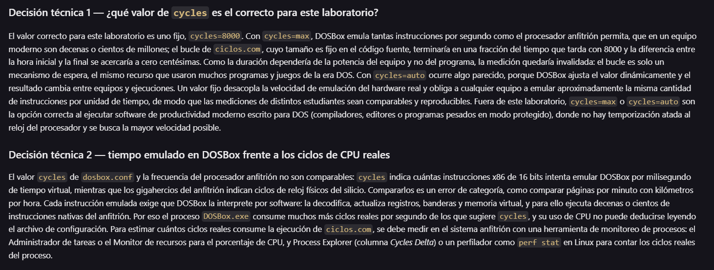

---

# Parte 2 — VirtualBox: creación y gestión de máquinas virtuales

## Entorno de la Parte 2

| Elemento | Valor |
|---|---|
| Virtualizador | Oracle VirtualBox 7.2.20 (hipervisor Tipo 2) |
| Sistema anfitrión | Windows 11 |
| Máquina virtual | Lab5-Alpine (tipo Linux, Other Linux 64-bit) |
| Sistema huésped | Alpine Linux 3.19.1 Standard x86_64 |
| RAM | 1024 MB inicial; 2048 MB después del Paso 5 |
| CPUs virtuales | 1 inicial; 2 después del Paso 5 |
| Disco principal | Lab5-Alpine.vdi, VDI de asignación dinámica, 10 GB |
| Disco secundario | Lab5-Alpine-fixed.vdi, VDI de asignación fija, 4 GB (solo para el benchmark) |
| Red inicial | NAT |

El estudiante creó la VM con el asistente gráfico de VirtualBox (opción A de la guía) y gestionó el resto del laboratorio con `VBoxManage` (snapshots, `modifyvm`, `createmedium`, `storageattach` y `export`) y con la interfaz gráfica (modos de red y retiro del ISO). Todos los comandos y acciones quedaron documentados en `VBoxManage_commands.sh`. Los discos `.vdi` y el archivo `.ova` se guardaron en la carpeta `VirtualBox VMs` del usuario, fuera del repositorio, y están excluidos con `.gitignore` por su tamaño.

### Notas de ejecución

- Los modos de red se cambiaron desde Configuración → Red → Adaptador 1, con la VM apagada. En Host-Only se usó el adaptador `VirtualBox Host-Only Ethernet Adapter`; en Bridge, el único adaptador físico disponible, `Realtek PCIe GbE Family Controller`.
- El ISO se retiró de la unidad óptica desde Configuración → Almacenamiento antes del primer arranque desde disco.
- En el benchmark con `dd` se añadió `conv=fsync` para que el tiempo medido incluya el vaciado de la caché a disco y no solo la escritura en memoria.
- Después de restaurar `snap_base`, la VM se reanudó en el estado en que se tomó ese snapshot (en caliente), por lo que el título de la ventana muestra `(snap_base)`.

## Capturas por checkpoint

### Checkpoint 1 — VM creada y configurada

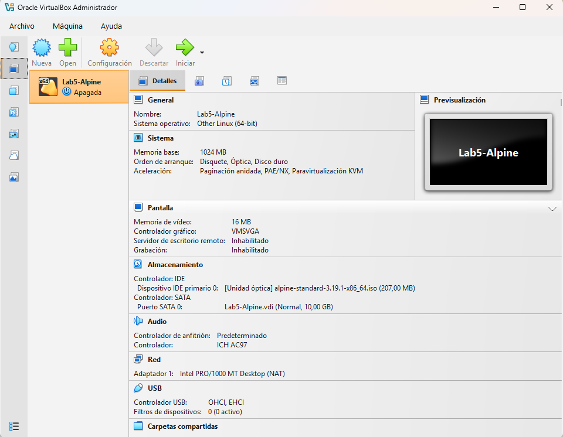

### Checkpoint 2 — Alpine Linux instalado y operativo

La VM arranca desde el disco, el login como root funciona, `ip addr show eth0` muestra la IP 10.0.2.15 de la red NAT de VirtualBox y `ping -c 3 8.8.8.8` responde con 0 % de pérdida.

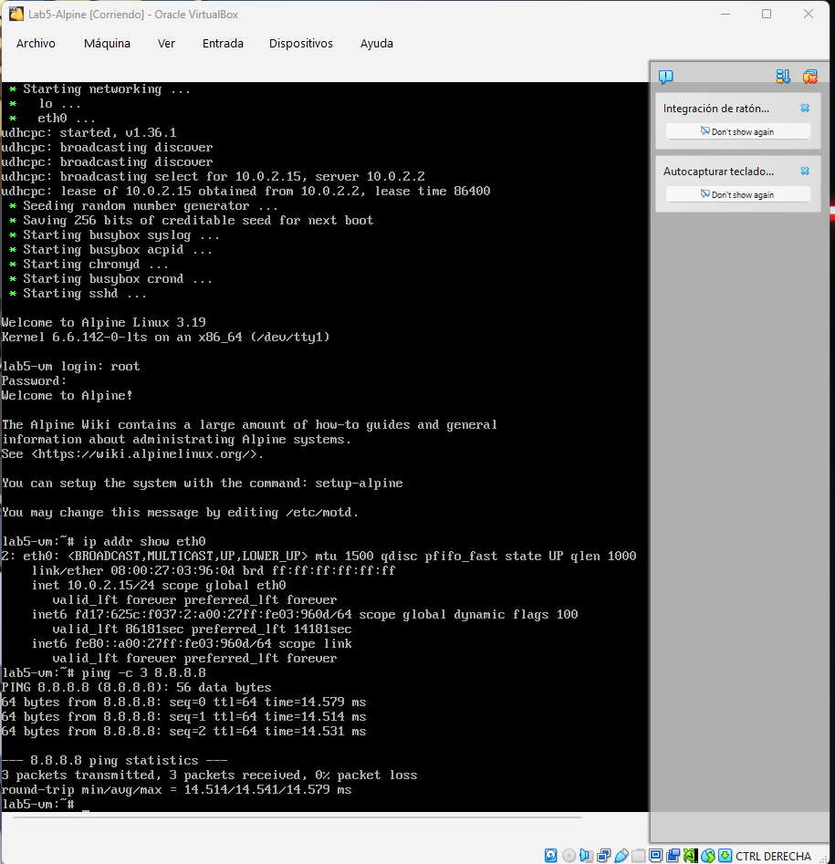

### Checkpoint 3 — Modos de red verificados

Modo NAT: ver la captura del Checkpoint 2.

**Host-Only** (IP en la red 192.168.56.x; el anfitrión llega a la VM, la VM no llega a internet):

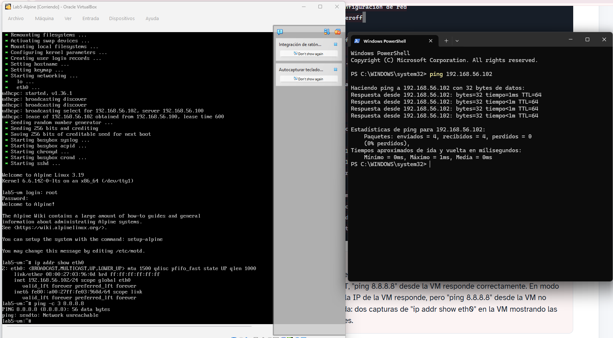

**Bridge** (IP en la red local; la VM tiene internet y es alcanzable desde el anfitrión):

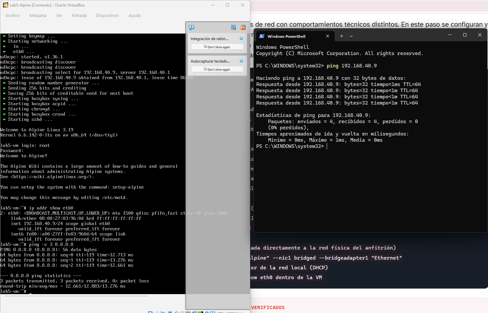

#### Tabla de IPs obtenidas por modo de red

| Modo | IP de la VM (`ip addr show eth0`) | `ping -c 3 8.8.8.8` desde la VM | Ping desde el anfitrión a la VM |
|---|---|---|---|
| NAT | 10.0.2.15 | Responde (0 % de pérdida) | No aplica: la VM no es alcanzable desde la red local |
| Host-Only | 192.168.56.102 | No responde (`Network unreachable`) | Responde (4 de 4 paquetes) |
| Bridge | 192.168.40.9 | Responde (0 % de pérdida) | Responde (4 de 4 paquetes) |

### Checkpoint 4 — Snapshots creados y restauración verificada

Árbol de snapshots (salida de `VBoxManage snapshot "Lab5-Alpine" list`):

```
   Name: snap_base (UUID: a36d730f-127d-4f9d-a869-f56acdf963c6)
   Description: Alpine Linux 3.19 recien instalado, sin modificaciones
      Name: snap_con_herramientas (UUID: 65d5ad31-06db-4489-8b78-afd9e0b92af5) *
      Description: Alpine con curl, wget, nano y htop instalados
```

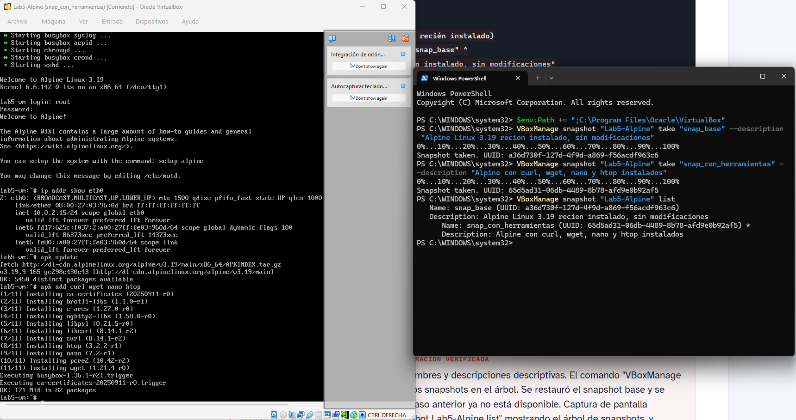

Después de restaurar `snap_base`, `curl` ya no está disponible dentro de la VM:

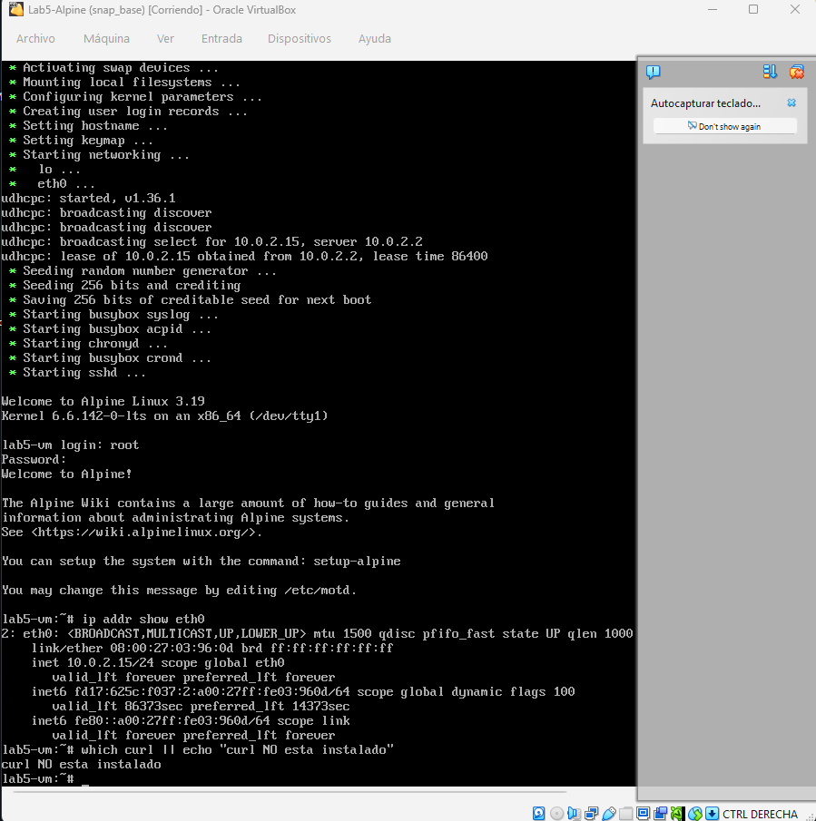

### Checkpoint 5 — Recursos reasignados y verificados

| Parámetro | Antes (Paso 1) | Después (Paso 5) | Verificación dentro de la VM |
|---|---|---|---|
| CPUs virtuales | 1 | 2 | `nproc` → 2 |
| Memoria RAM | 1024 MB | 2048 MB | `free -m`, total: 1976 |

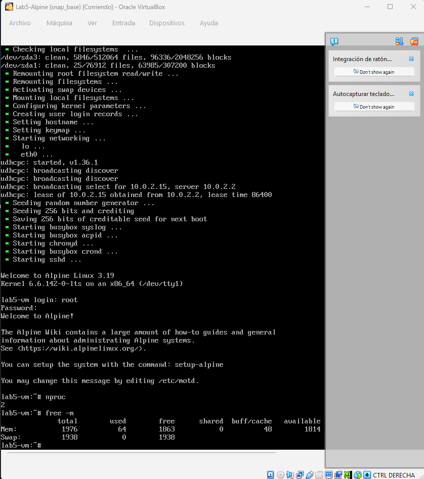

### Checkpoint 6 — Comparación de disco dinámico y disco fijo

Escritura secuencial de 200 MB con `dd if=/dev/zero bs=1M count=200 conv=fsync`, una sola ejecución por disco:

| Tipo de disco | Comando | Tiempo real (campo `real` de `time`) | Velocidad reportada por `dd` |
|---|---|---|---|
| Fijo (Lab5-Alpine-fixed.vdi) | `dd` sobre `/mnt/fijo/test.img` | 1.35 s | 147.6 MB/s |
| Dinámico (Lab5-Alpine.vdi) | `dd` sobre `/root/test.img` | 1.39 s | 143.3 MB/s |

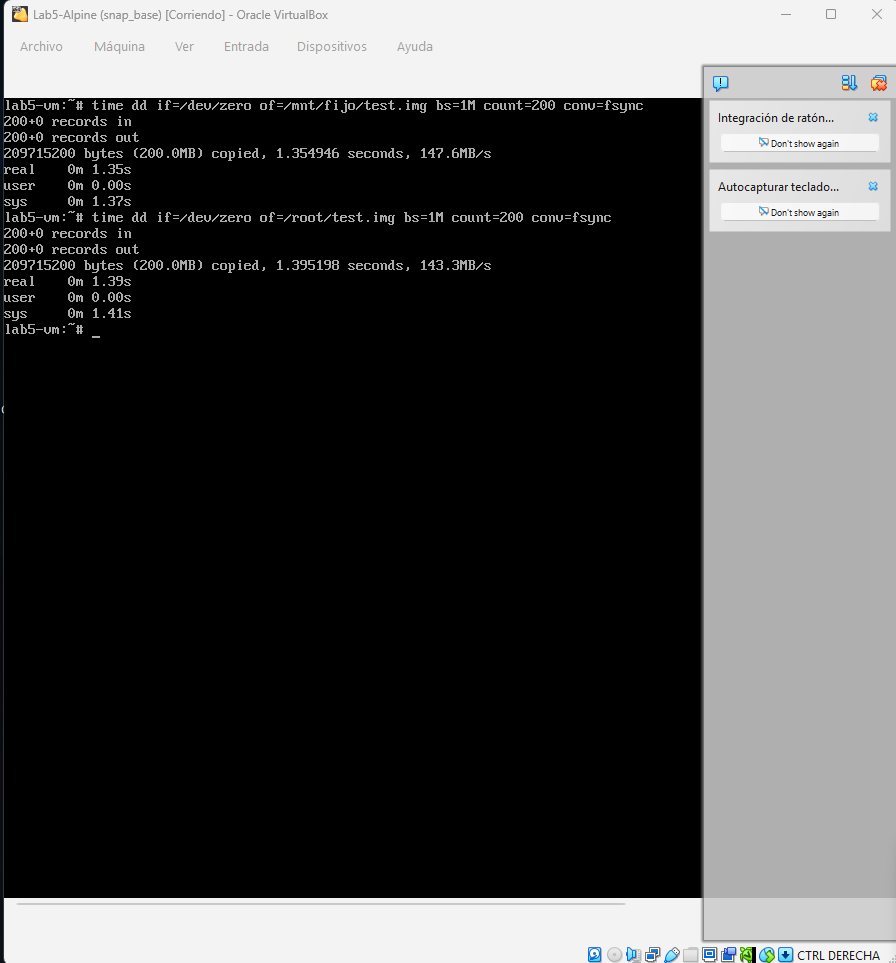

### Checkpoint 7 — Decisiones técnicas de red y almacenamiento

Las dos decisiones técnicas de la Parte 2 están redactadas más abajo en este documento.

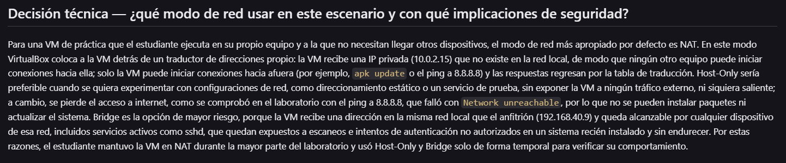

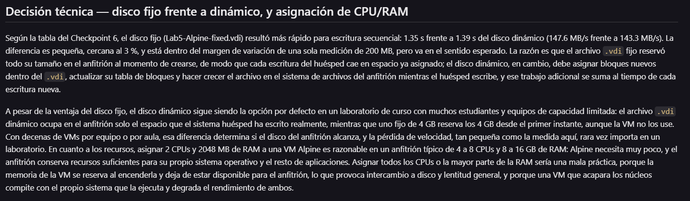

### Checkpoint 8 — Exportación OVA y repositorio consolidado

La VM se exportó con `VBoxManage export` en formato OVA con manifiesto. El archivo `Lab5-Alpine-export.ova` (152171520 bytes, unos 145 MB) no se sube al repositorio por su tamaño; se conserva en la carpeta `VirtualBox VMs` del usuario.

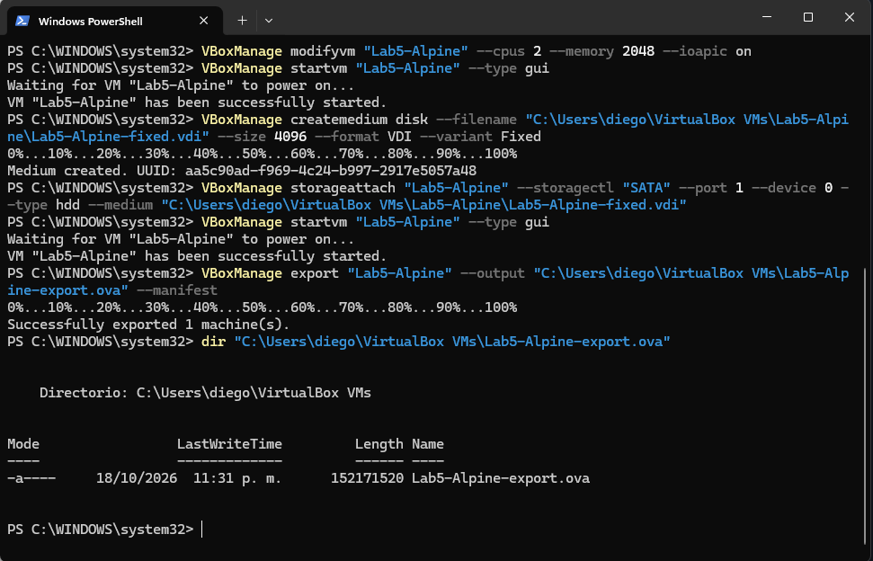

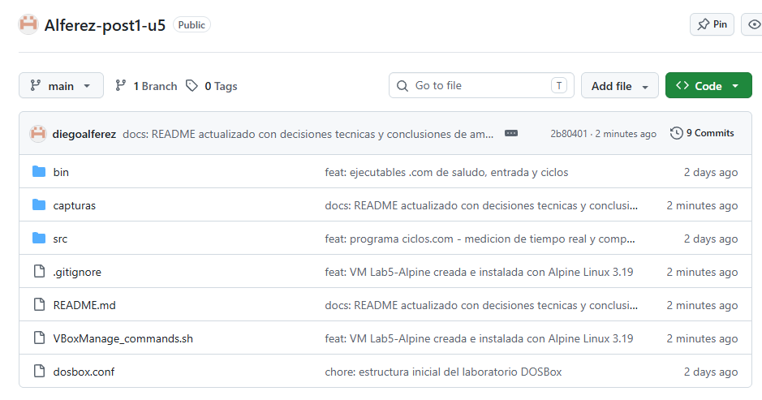

## Decisión técnica — ¿qué modo de red usar en este escenario y con qué implicaciones de seguridad?

Para una VM de práctica que el estudiante ejecuta en su propio equipo y a la que no necesitan llegar otros dispositivos, el modo de red más apropiado por defecto es NAT. En este modo VirtualBox coloca a la VM detrás de un traductor de direcciones propio: la VM recibe una IP privada (10.0.2.15) que no existe en la red local, de modo que ningún otro equipo puede iniciar conexiones hacia ella; solo la VM puede iniciar conexiones hacia afuera (por ejemplo, `apk update` o el ping a 8.8.8.8) y las respuestas regresan por la tabla de traducción. Host-Only sería preferible cuando se quiera experimentar con configuraciones de red, como direccionamiento estático o un servicio de prueba, sin exponer la VM a ningún tráfico externo, ni siquiera saliente; a cambio, se pierde el acceso a internet, como se comprobó en el laboratorio con el ping a 8.8.8.8, que falló con `Network unreachable`, por lo que no se pueden instalar paquetes ni actualizar el sistema. Bridge es la opción de mayor riesgo, porque la VM recibe una dirección en la misma red local que el anfitrión (192.168.40.9) y queda alcanzable por cualquier dispositivo de esa red, incluidos servicios activos como sshd, que quedan expuestos a escaneos e intentos de autenticación no autorizados en un sistema recién instalado y sin endurecer. Por estas razones, el estudiante mantuvo la VM en NAT durante la mayor parte del laboratorio y usó Host-Only y Bridge solo de forma temporal para verificar su comportamiento.

## Decisión técnica — disco fijo frente a dinámico, y asignación de CPU/RAM

Según la tabla del Checkpoint 6, el disco fijo (Lab5-Alpine-fixed.vdi) resultó más rápido para escritura secuencial: 1.35 s frente a 1.39 s del disco dinámico (147.6 MB/s frente a 143.3 MB/s). La diferencia es pequeña, cercana al 3 %, y está dentro del margen de variación de una sola medición de 200 MB, pero va en el sentido esperado. La razón es que el archivo `.vdi` fijo reservó todo su tamaño en el anfitrión al momento de crearse, de modo que cada escritura del huésped cae en espacio ya asignado; el disco dinámico, en cambio, debe asignar bloques nuevos dentro del `.vdi`, actualizar su tabla de bloques y hacer crecer el archivo en el sistema de archivos del anfitrión mientras el huésped escribe, y ese trabajo adicional se suma al tiempo de cada escritura nueva.

A pesar de la ventaja del disco fijo, el disco dinámico sigue siendo la opción por defecto en un laboratorio de curso con muchos estudiantes y equipos de capacidad limitada: el archivo `.vdi` dinámico ocupa en el anfitrión solo el espacio que el sistema huésped ha escrito realmente, mientras que uno fijo de 4 GB reserva los 4 GB desde el primer instante, aunque la VM no los use. Con decenas de VMs por equipo o por aula, esa diferencia determina si el disco del anfitrión alcanza, y la pérdida de velocidad, tan pequeña como la medida aquí, rara vez importa en un laboratorio. En cuanto a los recursos, asignar 2 CPUs y 2048 MB de RAM a una VM Alpine es razonable en un anfitrión típico de 4 a 8 CPUs y 8 a 16 GB de RAM: Alpine necesita muy poco, y el anfitrión conserva recursos suficientes para su propio sistema operativo y el resto de aplicaciones. Asignar todos los CPUs o la mayor parte de la RAM sería una mala práctica, porque la memoria de la VM se reserva al encenderla y deja de estar disponible para el anfitrión, lo que provoca intercambio a disco y lentitud general, y porque una VM que acapara los núcleos compite con el propio sistema que la ejecuta y degrada el rendimiento de ambos.

## Conclusiones de ambas partes

**Emulación frente a virtualización.** En la Parte 1, DOSBox emuló por software un procesador x86 de 16 bits y el entorno DOS: cada instrucción del programa fue interpretada por DOSBox, lo que permite ejecutar código de otra época sin depender del hardware real, pero a costa de velocidad. En la Parte 2, VirtualBox virtualizó una máquina x86-64 sobre un procesador x86-64: el código del huésped se ejecuta directamente en la CPU física con ayuda de las extensiones de virtualización, y el hipervisor solo interviene en el acceso a dispositivos y en las operaciones privilegiadas, por lo que el rendimiento se acerca al nativo. La emulación puede recrear una arquitectura distinta de la del anfitrión; la virtualización requiere la misma arquitectura.

**Cycles y velocidad de emulación.** En DOSBox, el valor de `cycles` no cambia la corrección de un programa, sino la velocidad a la que se emulan sus instrucciones: con un valor bajo el mismo bucle de trabajo tarda más tiempo real y con uno alto tarda menos. Por eso un valor fijo es el apropiado para un laboratorio reproducible, y `cycles` no es comparable con los ciclos de reloj reales del procesador anfitrión.

**Modos de red.** NAT dio acceso a internet con la VM aislada de la red local; Host-Only permitió comunicación solo entre anfitrión y VM, sin internet; Bridge dejó la VM como un equipo más de la red local, con mayor exposición. Para una VM de laboratorio personal, NAT es el modo por defecto más seguro.

**Snapshots.** Los snapshots permitieron volver al estado recién instalado sin desinstalar manualmente el software añadido (curl, wget, nano y htop), lo que hace seguro experimentar con la configuración del sistema: si algo falla, se restaura el estado anterior.

**Recursos y almacenamiento.** `modifyvm` permitió cambiar CPUs y RAM de una VM ya creada y verificarlo desde el huésped con `nproc` y `free -m`. La comparación de discos mostró el compromiso entre rendimiento potencial (disco fijo, ligeramente más rápido en la medición) y uso eficiente del espacio (disco dinámico). La exportación en formato OVA dejó la VM empaquetada de forma portable para otra instalación de VirtualBox o VMware.

